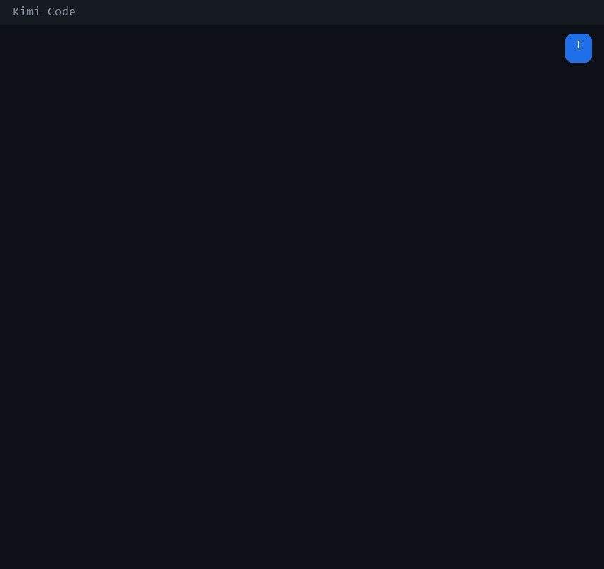
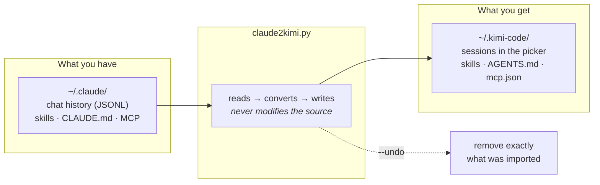

# claude-migrate

[Русский](README.md) | **English**

[](https://github.com/QweRezX/claude-migrate-kimi/actions/workflows/test.yml)
[](https://github.com/QweRezX/claude-migrate-kimi/releases/latest)
[](LICENSE)

**Moving from Claude Code to Kimi Code? Bring your chats with you.**
One Python file, no dependencies — your Claude conversations reappear in the
Kimi Code session picker with their original titles and dates, readable like
native sessions.


## 60-second quickstart

**What you need:**
- Python 3.10+ (macOS/Linux already have it; on Windows get it from [python.org](https://www.python.org/downloads/));
- your Claude Code files on the same machine (Claude Code itself doesn't need to be running — the tool only reads files);
- Kimi Code (only needed at the end, to see the result).

> ⚠️ **Windows:** use `python` instead of `python3` — bare `python3` there
> is often a Microsoft Store stub that just prints "Python" instead of
> running the script.

```bash
# 1. Create a folder, cd into it, download the tool (one file)
mkdir claude-migrate
cd claude-migrate
curl -LO https://raw.githubusercontent.com/QweRezX/claude-migrate-kimi/main/scripts/claude2kimi.py

# 2. Run it — an interactive wizard walks you through everything
python3 claude2kimi.py
```

The wizard lists what it found and asks what to import (everything, one
project, recent only) — nothing is written without your confirmation.

**3. Restart Kimi Code** — your Claude sessions appear in the session picker.
Something wrong? `python3 claude2kimi.py --undo` puts everything back.

> No terminal skills? Download
> [`claude2kimi-v*.zip` from the latest release](https://github.com/QweRezX/claude-migrate-kimi/releases/latest),
> unzip, and run the same commands in that folder.

## Pick your scenario

All flags below are appended to `python3 claude2kimi.py`
(e.g. `python3 claude2kimi.py --all --list`).

| I want to… | Run |
|---|---|
| Migrate from **Codex** (CLI/Desktop) | `--from codex --all` |
| Just look at what would be imported | `--all --list` |
| Import everything | `--all` |
| Try one session first (recommended) | `<path to one .jsonl from --list>` |
| Import only one project's chats | `--all --project waiterhelper` |
| Import only recent chats | `--all --since 2026-10-01` |
| Keep the assistant's thinking blocks too | `--all --with-thinking` |
| Keep tool calls/results too | `--all --with-tools` |
| Move skills, CLAUDE.md and MCP servers as well | `--config` |
| Read chats without Kimi (e.g. share as text) | `--all --to-md ./export` |
| Project moved to a new path/machine | `--all --rewrite-cwd /old/path=/new/path` |
| Undo the whole import | `--undo` |
| Report a problem | add `--report report.json` and [send it](FEEDBACK.md) |

Run `python3 claude2kimi.py --help` for the built-in summary, or the
[**full CLI reference**](docs/cli-reference.md) for detailed docs on every
flag — examples, combinations and safety notes.

## Install as a Kimi Code skill

A *skill* is a folder of instructions Kimi Code picks up automatically: with
it installed you don't run the script yourself — just ask the agent, and it
will do everything, asking what exactly you need first.



**Option 1 — just ask Kimi Code** (copy-paste into the chat):

```text
Install the claude-migrate skill from github.com/QweRezX/claude-migrate-kimi
and import my Claude Code (or Codex) sessions. Show me what you find first
and ask what exactly to import.
```

**Option 2 — install manually:**

```bash
git clone https://github.com/QweRezX/claude-migrate-kimi ~/.kimi-code/skills/claude-migrate
```

(or unzip [the repo archive](https://github.com/QweRezX/claude-migrate-kimi/archive/refs/heads/main.zip)
into `~/.kimi-code/skills/claude-migrate/`) — then just tell the agent:
*"import my Claude Code sessions"*.

## How it works



- **Sources:** Claude Code (`~/.claude/projects/`) and Codex CLI/Desktop (`~/.codex/sessions/`, via `--from codex`). Codex reasoning blocks are encrypted by OpenAI and cannot be imported; `.zst` archives are skipped for now.
- **Source (Claude):** sessions live as JSONL under `~/.claude/projects/`.
  Discovery is by content, not folder name — `$CLAUDE_CONFIG_DIR` is honored,
  and any custom location can be added with `--claude-dir /path`.
- **Target:** each conversation is recreated as a native Kimi Code session
  (`state.json` + `wire.jsonl` — Kimi's internal event-log format, the
  "wire protocol") and mapped to a *workspace* (a project in Kimi's sidebar)
  by its original working directory.
- **Idempotent:** already-imported sessions are skipped (`--force` re-imports).
- **Tagged & reversible:** every imported session carries
  `custom.importedFrom: "claude-code"` — `--undo` removes exactly those and
  nothing else.

## Safety

- Only **adds** files; existing sessions and configs are never modified or
  overwritten (`--config` skips anything that already exists).
- `session_index.jsonl` is backed up to `session_index.jsonl.bak` before each batch.

## Platform support

Works on **Windows, macOS and Linux** — pure `pathlib`, no shell calls, no
dependencies beyond Python 3.10+. Tested in CI on all three OSes × Python
3.10/3.12 against wire protocol 1.5.

| | Windows | macOS / Linux |
|---|---|---|
| Kimi Code data | `C:\Users\<name>\.kimi-code` | `~/.kimi-code` |
| Claude Code sessions | `C:\Users\<name>\.claude\projects` | `~/.claude/projects` |

`KIMI_CODE_HOME` is honored for the Kimi side.

## Feedback & known limitations

The Kimi wire format is **undocumented** and may change between releases —
verified against `protocol_version: 1.5` (the tool warns you if it detects a
different one). The import is a faithful *readable* copy, not a byte-exact
replica: attachments are not carried over, and imported sessions are meant for
reading/reference, not for resuming mid-task.

Found a glitch? Run with `--report report.json` and share it per
[FEEDBACK.md](FEEDBACK.md) or [open an issue](../../issues) — the report
contains versions, counts and skipped event types, never your message text.
Format notes for contributors: [references/formats.md](references/formats.md).

## Roadmap

- [x] `--list` — table of discovered sessions before importing
- [x] `--to-md` — export sessions to readable Markdown, no Kimi required
- [x] `--rewrite-cwd OLD=NEW` — retarget absolute paths on moved projects/machines
- [x] `--config` — full-move mode: skills, `CLAUDE.md` → `AGENTS.md`, MCP configs
- [ ] reverse export (Kimi Code → Claude Code)

Contributions welcome — open an issue to discuss before large PRs.

## Related tools

No other tool imports Claude Code sessions **into Kimi Code** (this repo is,
as far as we know, the first). Neighboring projects:

- [a2migrate](https://github.com/MrMirhan/a2migrate) — Claude Code ↔ OpenCode session/skill/MCP migration (Go)
- [oh-my-pi](https://github.com/can1357/oh-my-pi) — agent with a built-in `--from-claude` importer
- [pi-import-claude-history](https://pi.dev/packages/pi-import-claude-history) — Claude → Pi importer
- [claude-conversation-transfer](https://github.com/arghhhhh/claude-conversation-transfer) — Claude ↔ Claude moves between machines, with path retargeting
- [claude-code-log](https://github.com/daaain/claude-code-log), [claude-JSONL-browser](https://github.com/withLinda/claude-JSONL-browser), [claude-code-transcripts](https://github.com/simonw/claude-code-transcripts) — render Claude sessions to HTML/Markdown

## License

MIT
