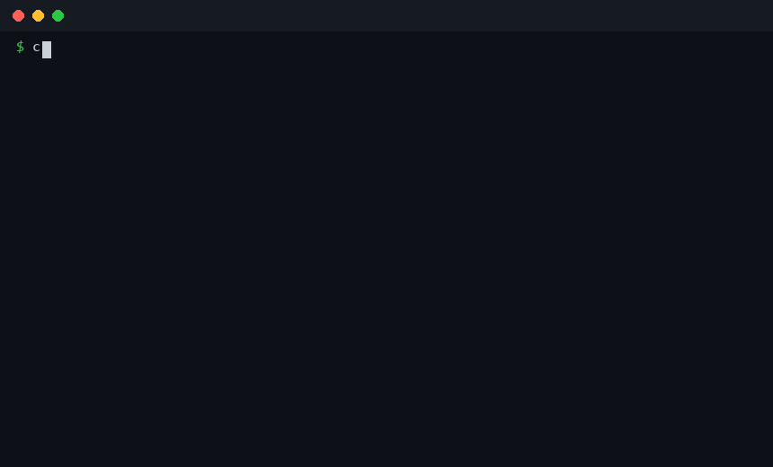
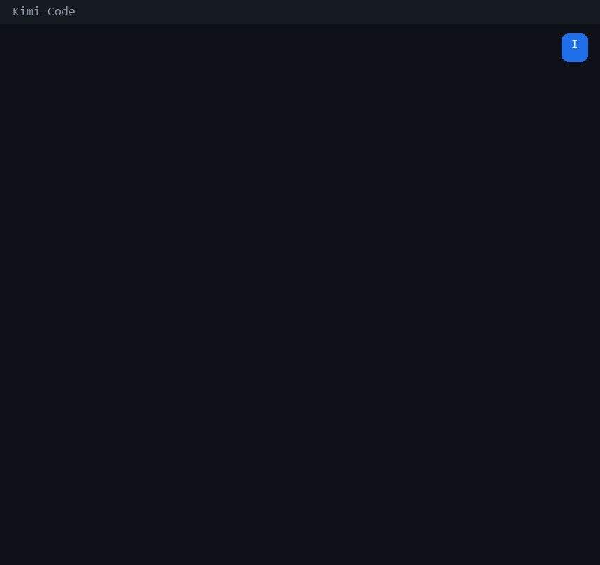
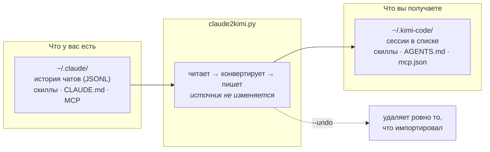

# claude-migrate

**Русский** | [English](README.en.md)

[](https://github.com/QweRezX/claude-migrate-kimi/actions/workflows/test.yml)
[](https://github.com/QweRezX/claude-migrate-kimi/releases/latest)
[](LICENSE)

**Переходите с Claude Code на Kimi Code? Заберите свои чаты с собой.**
Один Python-файл без зависимостей — ваши разговоры из Claude появятся в
списке сессий Kimi Code с оригинальными названиями и датами и откроются
как обычные чаты.



## Быстрый старт за 60 секунд

**Что понадобится:**
- Python 3.10+ (на macOS/Linux уже есть; на Windows — с [python.org](https://www.python.org/downloads/));
- файлы Claude Code на этом же компьютере (сам Claude Code запускать не нужно — инструмент читает только файлы);
- Kimi Code (понадобится только в конце, чтобы посмотреть результат).

```bash
# 1. Скачайте инструмент (один файл)
curl -LO https://raw.githubusercontent.com/QweRezX/claude-migrate-kimi/main/scripts/claude2kimi.py

# 2. Запустите — интерактивный мастер проведёт через всё сам
python3 claude2kimi.py
```

Мастер покажет список найденных сессий и спросит, что именно импортировать
(всё, один проект, только свежие) — ничего не записывается без вашего
подтверждения.

**3. Перезапустите Kimi Code** — сессии из Claude появятся в списке чатов.
Что-то не так? `python3 claude2kimi.py --undo` вернёт всё как было.

> Совсем не дружите с терминалом? Скачайте
> [`claude2kimi-v*.zip` из последнего релиза](https://github.com/QweRezX/claude-migrate-kimi/releases/latest),
> распакуйте и выполните те же команды в этой папке.

## Выберите свой сценарий

Все флаги ниже добавляются к команде `python3 claude2kimi.py`
(например: `python3 claude2kimi.py --all --list`).

| Я хочу… | Команда |
|---|---|
| Перенести из **Codex** (CLI/Desktop) | `--from codex --all` |
| Просто посмотреть, что будет импортировано | `--all --list` |
| Импортировать всё | `--all` |
| Сначала попробовать одну сессию (рекомендуется) | `<путь к одному .jsonl из --list>` |
| Импортировать чаты только одного проекта | `--all --project мойпроект` |
| Импортировать только свежие чаты | `--all --since 2026-10-01` |
| Сохранить и размышления ассистента | `--all --with-thinking` |
| Сохранить и вызовы инструментов | `--all --with-tools` |
| Перенести также скиллы, CLAUDE.md и MCP | `--config` |
| Читать чаты без Kimi (например, поделиться) | `--all --to-md ./export` |
| Проект переехал в другую папку/на другой ПК | `--all --rewrite-cwd /старый/путь=/новый/путь` |
| Откатить весь импорт | `--undo` |
| Сообщить о проблеме | добавьте `--report report.json` и [пришлите](FEEDBACK.md) |

Встроенная справка: `python3 claude2kimi.py --help`. Подробная документация
по каждому флагу (примеры, сочетания, замечания по безопасности) —
в [справочнике CLI](docs/cli-reference.md) (на английском).

## Установка как скилл Kimi Code

*Скилл* — это папка с инструкциями, которую Kimi Code подхватывает
автоматически: установив её, вы сможете не запускать скрипт руками, а просто
попросить агента: *«импортируй мои сессии из Claude»* — он сам всё сделает
и спросит, что именно вам нужно.



```bash
git clone https://github.com/QweRezX/claude-migrate-kimi ~/.kimi-code/skills/claude-migrate
```

(или распакуйте [архив репозитория](https://github.com/QweRezX/claude-migrate-kimi/archive/refs/heads/main.zip)
в `~/.kimi-code/skills/claude-migrate/`)

## Как это работает



- **Источники:** Claude Code (`~/.claude/projects/`) и Codex CLI/Desktop (`~/.codex/sessions/`, флаг `--from codex`). Размышления Codex зашифрованы OpenAI и не переносятся; архивы `.zst` пока пропускаются.
- **Источник (Claude):** сессии в JSONL в `~/.claude/projects/`.
  Поиск — по содержимому, а не по имени папки; учитывается
  `$CLAUDE_CONFIG_DIR`, свой путь можно добавить флагом `--claude-dir`.
- **Результат:** каждый разговор воссоздаётся как нативная сессия Kimi Code
  (`state.json` + `wire.jsonl` — внутренний формат журнала Kimi, «wire-протокол»)
  и попадает в *workspace* (проект в списке Kimi Code) по своей исходной
  рабочей папке.
- **Идемпотентность:** уже импортированные сессии пропускаются
  (`--force` — импортировать заново).
- **Метка и откат:** каждая импортированная сессия помечена
  `custom.importedFrom: "claude-code"` — `--undo` удаляет ровно их и
  ничего больше.

## Безопасность

- Инструмент только **добавляет** файлы; существующие сессии и конфиги
  никогда не изменяются и не перезаписываются (`--config` пропускает всё,
  что уже существует).
- Перед каждым пакетным импортом `session_index.jsonl` копируется в
  `session_index.jsonl.bak`.

## Поддержка платформ

Работает на **Windows, macOS и Linux** — чистый `pathlib`, без shell-вызовов,
без зависимостей кроме Python 3.10+. Протестировано в CI на всех трёх ОС ×
Python 3.10/3.12, wire-протокол 1.5.

| | Windows | macOS / Linux |
|---|---|---|
| Данные Kimi Code | `C:\Users\<имя>\.kimi-code` | `~/.kimi-code` |
| Сессии Claude Code | `C:\Users\<имя>\.claude\projects` | `~/.claude/projects` |

Переменная `KIMI_CODE_HOME` учитывается.

## Обратная связь и ограничения

Формат wire Kimi **не документирован** и может меняться между версиями —
проверено на `protocol_version: 1.5` (инструмент предупредит, если обнаружит
другой). Импорт — это читаемая копия, а не побайтовая реплика: вложения не
переносятся, импортированные сессии предназначены для чтения, а не для
продолжения работы с середины.

Нашли проблему? Запустите с `--report report.json` и пришлите по инструкции
из [FEEDBACK.md](FEEDBACK.md) или [создайте issue](../../issues) — отчёт
содержит версии, счётчики и типы пропущенных событий, но никогда — текст
переписки. Заметки о формате для контрибьюторов:
[references/formats.md](references/formats.md).

## Roadmap

- [x] `--list` — таблица найденных сессий перед импортом
- [x] `--to-md` — экспорт в читаемый Markdown без Kimi
- [x] `--rewrite-cwd OLD=NEW` — перенацеливание путей при переезде
- [x] `--config` — полный переезд: скиллы, `CLAUDE.md` → `AGENTS.md`, MCP
- [ ] обратный экспорт (Kimi Code → Claude Code)

Контрибуции приветствуются — для крупных PR сначала откройте issue.

## Похожие инструменты

Других инструментов для импорта сессий Claude Code **в Kimi Code** нет (этот
репозиторий, насколько нам известно, первый). Соседние проекты:

- [a2migrate](https://github.com/MrMirhan/a2migrate) — миграция Claude Code ↔ OpenCode: сессии, скиллы, MCP (Go)
- [oh-my-pi](https://github.com/can1357/oh-my-pi) — агент со встроенным импортёром `--from-claude`
- [pi-import-claude-history](https://pi.dev/packages/pi-import-claude-history) — импорт Claude → Pi
- [claude-conversation-transfer](https://github.com/arghhhhh/claude-conversation-transfer) — перенос Claude ↔ Claude между машинами
- [claude-code-log](https://github.com/daaain/claude-code-log), [claude-JSONL-browser](https://github.com/withLinda/claude-JSONL-browser), [claude-code-transcripts](https://github.com/simonw/claude-code-transcripts) — рендер сессий Claude в HTML/Markdown

## Лицензия

MIT
